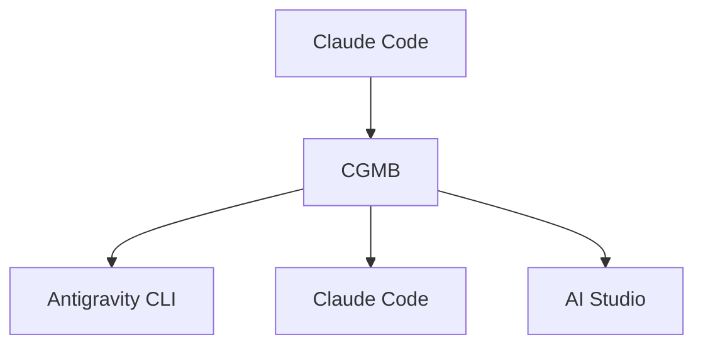

<div align="center">

# 🌉 Claude-Gemini Multimodal Bridge

### *Unifying the Power of AI.*

**An MCP bridge that seamlessly integrates Claude Code, Antigravity CLI, and Google AI Studio**

[🇯🇵 日本語版](README_JP.md) • [📦 NPM](https://www.npmjs.com/package/claude-gemini-multimodal-bridge) • [🐛 Issues](https://github.com/goodaymmm/claude-gemini-multimodal-bridge/issues)

---

[](https://www.npmjs.com/package/claude-gemini-multimodal-bridge)
[](https://opensource.org/licenses/MIT)
[](https://nodejs.org/)
[](https://www.typescriptlang.org/)

[](https://modelcontextprotocol.io/)
[](https://ai.google.dev/)
[](https://www.anthropic.com/)
[](https://github.com/sponsors/goodaymmm)

[](#-windows-environment)
[](#-quick-start)
[](#-quick-start)

</div>

---

## 🤔 Why CGMB?

<table>
<tr>
<td width="33%" align="center">

### 🔄 Multi-Model Orchestration

Optimally integrates Claude's **reasoning power**, Antigravity CLI's **search capabilities**, and AI Studio's **generation power**. Ahead of the 2026 AI trend: "Specialized AI Collaboration"

</td>
<td width="33%" align="center">

### ⚡ One Install, Two Setup Steps

`npm install -g` wires up the MCP integration. You then install `agy` and add an AI Studio API key

</td>
<td width="33%" align="center">

### 🎯 MCP Standard Compliant

Follows the Anthropic Model Context Protocol. 625 tests run on Linux, Windows and macOS in CI on every push

</td>
</tr>
</table>

---

## ✨ What's New in v1.3.0

Since 2026-09-18 Google serves the Gemini 2.5 models only to accounts that
already used them, so with a new API key the AI Studio layer returned nothing.
This release moves the AI Studio defaults off Gemini 2.5, adds a PDF mode that
reads PDFs with a text layer locally instead of uploading them, and raises the
Node.js floor to 22.12.0. It also makes routing do what the Automatic Routing
section says, and the environment variables do what the Configuration section
says. None of it ran against the live Gemini API or a real `agy` — see
Version History.

| Change | Description |
|--------|-------------|
| 🚀 **AI Studio defaults moved off Gemini 2.5** | `gemini-3.5-flash-lite` for general, document and multimodal work (same price as 2.5 Flash), `gemini-3.1-flash-lite-image` for images, `gemini-3.8-flash-tts` for speech |
| 🔑 **A new API key is no longer reported as broken** | The key check probed `gemini-2.5-flash`, which refuses new keys |
| 🎵 **Speech files get one WAV header** | 3.8 TTS returns a complete WAV file; it is written as-is instead of being wrapped a second time |
| 📄 **PDFs with a text layer are read locally** | Sent to Gemini as text; only scanned PDFs are uploaded. `auto` is the new default — `--pdf-mode upload` restores the old behaviour |
| 🔐 **The Antigravity sign-in check matches real requests** | `agy` no longer receives `GEMINI_API_KEY`, an API key no longer counts as a sign-in, and an expired sign-in reads as signed out |
| 🧭 **Antigravity CLI named throughout** | Remaining "Gemini CLI" hints now say `agy`; `cgmb detect-paths --fix` prints the `agy` install hint it never showed |
| 📦 **Dependencies on their current majors** | `@google/genai` 2, commander 15, dotenv 18, pdf-parse 2, zod 4; Node.js ≥ 22.12.0. Excess CLI arguments are now an error — quote prompts |
| 📌 **Lockfile committed** | `package-lock.json` is now in the repository; switching CI to `npm ci` is still pending |
| 🧠 **Claude Code answers reasoning and code** | Explain, compare, why, design, review and write / fix / refactor code — in English or Japanese — and source files now go to Claude Code, as the routing table says. No automatic route reached it before |
| 🎨 **Image and audio requests recognised as written** | "generate an image of …", 「イメージを生成」, "read this aloud", 「読み上げて」 and similar now reach the image and speech models; the README_JP image example made no image |
| 🌐 **PDF URLs are read** | Downloaded (50 MB, 30 s, 3 redirects) and uploaded; Gemini used to answer from the prompt alone |
| 📎 **A web page URL plus files reads both** | The page through `agy`, the files through AI Studio; the files used to be dropped |
| 🧹 **`layer_priority` and `--strategy` no longer advertised** | Nothing read them; still accepted, with no effect |
| 🚫 **`--layer` refuses files the layer cannot read** | As the MCP tool's `targetLayer` already did |
| 🔁 **MCP search falls back like the CLI** | `agy` → AI Studio → Claude Code; the answer says so, and when every layer fails the error names each one |
| 🗑️ **Unreachable code and unused packages removed** | 1,584 lines nothing could reach and four unused dependencies (19 fewer installed packages); the package ships 68 files instead of 112, and nothing from `.claude/worktrees` |
| 🧩 **Workflows checked before they run** | A `dependsOn` naming a missing step, a self-dependency, a cycle or a duplicate step id is refused before any step runs; `synthesize_response` now receives every input |
| ⚙️ **Documented settings take effect** | `CACHE_TTL` is in seconds, `ENABLE_CACHING=false` turns the search cache off, `MAX_RETRIES` / `RETRY_DELAY` are read, `--debug` works on every command, `cgmb info` checks `AI_STUDIO_API_KEY` |
| 🔇 **Prompts kept out of the log, tool schema fixed** | No more error lines and stack traces when output mentions "AI Studio"; below debug level, logs carry argument keys, lengths and URL hosts, not prompts; the `cgmb` tool accepts the `{prompt, args}` it advertises |

### Previously, in v1.2.2

Housekeeping. Nothing users can reach behaves differently — the code removed
could not be reached at all.

| Change | Description |
|--------|-------------|
| 🧹 **Four dead call paths removed** | The layer asked the MCP server for tools it has never implemented. Unreachable today, but that is what `--script` was too |
| 🗑️ **740 lines of unused modules removed** | `PromptOptimizer` and `quotaMonitor` had no reference anywhere and were still being shipped |
| 🔒 **The layer and its server are now checked against each other** | A test starts the server, asks what it implements, and fails if the layer can name anything else |

### Previously, in v1.2.1

| Fix | Description |
|-----|-------------|
| 🎯 **Answers reach the caller who asked** | Concurrent AI Studio requests took each other's replies; each now gets its own |
| 🚪 **`cgmb` exits when it is done** | The shared MCP server is ended rather than left running |
| 🔑 **`.env` stays in your project** | Installation directories and `~/.cgmb` are opt-in via `CGMB_ENV_PATH`, not read by default |
| 🔍 **Search cache answers the question asked** | Different years and different models are no longer treated as one entry |
| 🧩 **Workflow steps see their inputs** | Parallel steps publish output; hybrid runs honour `dependsOn` |

---

## 🏗️ Architecture



| Layer | Specialization | Timeout |
|:-----:|:---------------|:-------:|
| 🔍 Antigravity CLI (`agy`) | Web search, real-time information | 90s |
| 🧠 Claude Code | Complex reasoning, code analysis | 300s |
| 🎨 AI Studio | Image generation, audio synthesis, OCR | 300s |

---

## 🚀 Quick Start

### 📋 Prerequisites

- **Node.js** ≥ 22.12.0
- **Claude Code CLI** installed
- **Antigravity CLI** (`agy`) ≥ 1.1.7 — installed separately, see below

### 📦 Installation

```bash
npm install -g claude-gemini-multimodal-bridge
```

> 💡 The postinstall script automatically:
> - Checks for the Antigravity CLI and prints install instructions if missing
> - Sets up Claude Code MCP integration
> - Tells you where the API key goes (it does not write a `.env`)
> - Verifies system requirements

### 🔑 Environment Setup

Create a `.env` file in your working directory:

```bash
AI_STUDIO_API_KEY=your_api_key_here
```

🔗 Get API key: https://aistudio.google.com/app/apikey

### 🎯 Antigravity CLI Setup

Google discontinued Gemini CLI for individual accounts on 2026-06-18. The
search layer now runs on its successor, the Antigravity CLI (`agy`), which is
not distributed on npm and must be installed separately:

```bash
# Windows (PowerShell)
irm https://antigravity.google/cli/install.ps1 | iex

# macOS / Linux
curl -fsSL https://antigravity.google/cli/install.sh | bash
```

Then sign in once — this opens a browser and stores the OAuth token in your
OS keyring. There is no API key and no `agy auth` subcommand:

```bash
agy
```

Verify with `agy models`; CGMB requires **agy 1.1.7 or newer** (earlier builds
print nothing when stdout is not a terminal).

`cgmb detect-paths` shows which `agy` CGMB found, and it and `cgmb info` show
whether `ANTIGRAVITY_CLI_PATH` is set. A `GEMINI_CLI_PATH` left over from Gemini
CLI is ignored unless it points at `agy`; set `ANTIGRAVITY_CLI_PATH` instead.

### 💬 Get Started with Claude Code

```
I installed CGMB via NPM. Please check my current environment for the cgmb command and help me use it.
```

---

## 💡 Usage Examples

CGMB integrates seamlessly with Claude Code. Just use the **"CGMB" keyword**:

```bash
# 🎨 Image generation
"CGMB generate an image of a futuristic city"

# 📄 Document analysis (use absolute paths)
"CGMB analyze the document at /full/path/to/report.pdf"

# 🌐 URL analysis
"CGMB analyze https://example.com/document.pdf"

# 🔍 Web search
"CGMB search for the latest AI news"

# 🎵 Audio generation
"CGMB create audio saying 'Welcome to our podcast'"

# 📝 OCR-enabled PDF analysis
"CGMB analyze this scanned PDF document with OCR"
```

### 🔄 Automatic Routing

1. Include **"CGMB"** in your Claude Code request
2. CGMB automatically routes to the optimal AI layer:
   - **🔍 Antigravity CLI**: Web search, latest information
   - **🎨 AI Studio**: Images, audio, file processing
   - **🧠 Claude Code**: Complex reasoning, code analysis

Reasoning means asking to explain, compare, analyse, design or review
something, or asking why; code means writing, fixing, refactoring or reviewing
code, or attaching source files (their text is passed to Claude Code, up to
200 KB). Wording about the web or the present (latest, today, news, search)
goes to the Antigravity CLI first, and requests to generate an image or audio go
to AI Studio first; a short question with none of these signals goes to the
Antigravity CLI. A web page URL is read by the Antigravity CLI and a PDF URL is
downloaded and read by AI Studio; with files attached as well, each goes to its
layer and both answers are returned. If Claude Code is not installed or signed
in, its requests go to the Antigravity CLI.

---

## 🤖 Models Used

| Purpose | Model ID | Layer |
|:-------:|:---------|:-----:|
| 🔍 Web Search | `gemini-3.6-flash-low` | Antigravity CLI |
| 🎨 Image Generation | `gemini-3.1-flash-lite-image` | AI Studio |
| 🎵 Audio Generation | `gemini-3.8-flash-tts` | AI Studio |
| 📄 Document Processing | `gemini-3.5-flash-lite` | AI Studio |
| 📝 OCR/Text Extraction | `gemini-3.5-flash-lite` | AI Studio |
| 🔮 General Multimodal | `gemini-3.5-flash-lite` | AI Studio |

The Antigravity row is the default. Which Antigravity IDs are valid is decided
by `agy models` on your machine — the catalogue varies by account and plan (a
listing reported on agy 1.2.16 has the `gemini-3.6`, `3.7` and `3.8` Flash
tiers, `-low` / `-medium` / `-high`); pick another with `ANTIGRAVITY_MODEL` or
`--model`. AI Studio IDs live in `AI_MODELS` in `src/core/types.ts`.

---

## 📈 Performance

What the implementation actually does, rather than a benchmark:

| Mechanism | Where it applies | Tunable with |
|-----------|------------------|--------------|
| Search result cache | Repeated web-search prompts | `ENABLE_CACHING`, `CACHE_TTL`, `MAX_CACHE_ENTRIES` |
| Authentication cache | `agy` and Claude Code probes, cached for hours rather than per call | — |
| Lazy layer initialisation | A layer is started on first use, not at startup | — |
| Retry with exponential backoff | Transient API and CLI failures | `MAX_RETRIES`, `RETRY_DELAY` |

Throughput depends on which layer answers and on the upstream API, so no fixed
numbers are quoted here.

---

## 📄 PDF Processing & OCR

### ✨ OCR Features

- ✅ Supports both text-based and scanned PDFs
- ✅ Automatic OCR detection: text is extracted locally first
- ✅ Native OCR processing via Gemini File API for scanned PDFs
- ✅ Multi-language support

### 📋 Processing Workflow

```
PDF Input → Local text extraction ─┬─ text layer        → Text to Gemini      → Output Results
                                   └─ scanned / no text → Upload → Gemini OCR → Output Results
```

A page counts as text when it has at least 100 characters, not counting
spaces; a PDF is sent as text when at least 4 in 5 of its pages are. Text is
cheaper and skips the upload, but Gemini then sees only the words: figures,
charts and the page layout do not reach it. To have Gemini look at the pages
themselves, upload:

| Mode | Behaviour | Set with |
|------|-----------|----------|
| `auto` (default) | Local text when the PDF has a text layer, upload otherwise | — |
| `local` | Always local text; a PDF with no text is refused | `--pdf-mode local` |
| `upload` | Always upload (the behaviour up to 1.2.2) | `--pdf-mode upload` |

`--pdf-mode` works on `analyze`, `multimodal`, `process` and `aistudio`; MCP
callers pass `options.pdf_mode`. `CGMB_PDF_MODE` sets the default and
`CGMB_PDF_TEXT_MIN_CHARS` the per-page threshold. PDF URLs are always uploaded.

### 📁 Supported Formats

- Text-based PDFs
- Scanned PDFs (OCR processing)
- Image-based PDFs (OCR conversion)
- Mixed content
- Complex layouts (tables, charts, formatted content)

---

## 📂 File Organization

Generated content is automatically organized:

```
output/
├── images/     # 🎨 Generated images
├── audio/      # 🎵 Generated audio files
└── documents/  # 📄 Processed documents
```

Files are written to these directories under the working directory you ran CGMB
from, and the path of each generated file is returned in the response.

The MCP tools CGMB exposes to Claude Code are `cgmb`,
`cgmb_get_layer_requirements`, `cgmb_document_analysis`,
`cgmb_multimodal_process` and `cgmb_workflow_orchestration`.

---

## 🔧 Configuration

### Environment Variables

```bash
# Required
AI_STUDIO_API_KEY=your_api_key_here

# Search layer (Antigravity CLI)
ANTIGRAVITY_MODEL=gemini-3.6-flash-low   # must appear in `agy models`
ANTIGRAVITY_TIMEOUT=90000                # per-call budget, ms
ANTIGRAVITY_CLI_PATH=                    # unset = auto-detect

# Claude layer
CLAUDE_CODE_PATH=/usr/local/bin/claude   # for installs outside the defaults

# PDFs: auto | local | upload (see PDF Processing & OCR)
CGMB_PDF_MODE=auto
CGMB_PDF_TEXT_MIN_CHARS=100
CGMB_ALLOW_PRIVATE_URLS=false            # true lets PDF URLs reach private/loopback addresses

# Search cache
ENABLE_CACHING=true                      # false (or 0 / no / off) turns it off
CACHE_TTL=3600                           # seconds, default 1800; 100000 or more is read as legacy ms, with a warning
MAX_CACHE_ENTRIES=1000

# Retries -- empty keeps each layer's own default; an invalid value is ignored with a warning
MAX_RETRIES=                             # retries after the first attempt, 0-10 (0 = no retry)
RETRY_DELAY=                             # ms before the first retry, 0-60000; later retries back off

# MCP server
REQUEST_TIMEOUT=300000                   # ms, limit for one cgmb / cgmb_multimodal_process / cgmb_document_analysis call

# Logging (stderr)
LOG_LEVEL=info                           # error | warn | info | debug; --debug on any command sets debug
CGMB_DEBUG=false                         # true = debug level, like --debug
LOG_FILE=                                # also write the log to this file

# Deprecated fallback for AI_STUDIO_API_KEY -- prefer the latter
GEMINI_API_KEY=your_api_key_here
```

### 🔐 Which files may be sent to Google

The AI Studio layer uploads file contents to Google, so it only reads from the
directory CGMB was started in. To analyse files kept elsewhere, list those
directories explicitly:

```bash
# ";" separated on Windows, ":" elsewhere
CGMB_ALLOWED_ROOTS=C:\Users\me\Documents;D:\shared
```

### 📍 Where `.env` is read from

CGMB reads `.env` from the directory you run it in. Up to 1.2.0 it also read
CGMB's own installation directory, the global npm directory and `~/.cgmb`, so a
file left in any of those was picked up by every project on the machine — along
with its `AI_STUDIO_API_KEY` and its `CGMB_ALLOWED_ROOTS`, which is what decides
the boundary above. Since 1.2.1 those locations have to be named:

```bash
# A file, or the directory holding one. Consulted before the working directory.
CGMB_ENV_PATH=/home/me/.cgmb/.env
```

**Upgrading from 1.2.0 or earlier**: if your key lived in one of those
locations, set this to keep using it — otherwise CGMB will report the key as
missing.

`.env.example` carries the full list, including the keys that are parsed but
that nothing reads back — worth checking before assuming a setting has an effect.
`GEMINI_MODEL`, `GEMINI_TIMEOUT`, `GEMINI_MAX_OUTPUT_TOKENS`,
`GEMINI_TEMPERATURE`, `GEMINI_MAX_FILES`, `GEMINI_MAX_TOTAL_FILE_SIZE` and
`AISTUDIO_MCP_ENABLED` are among them: setting them changes nothing, and the
AI Studio model IDs are fixed in `AI_MODELS`.

### MCP Integration

The installer runs `cgmb setup-mcp`, which registers CGMB with Claude Code:
- ⚡ `claude mcp add claude-gemini-multimodal-bridge <node> <cgmb>/dist/cli.js serve`,
  with absolute paths, so the server does not depend on the PATH of the project
  Claude Code is started in
- ✅ Check with `claude mcp list`; if CGMB is missing, run `cgmb setup-mcp`
  (`--dry-run` prints the command instead)
- 🔒 A Claude Code without the `claude mcp` command gets an `mcp_servers.json`
  entry instead, merged without overwriting existing servers

---

## 🪟 Windows Environment

CGMB has **fully supported** Windows since v1.1.0:

| Feature | Status |
|---------|:------:|
| CLI | ✅ All commands work |
| MCP Integration | ✅ MCP tool calls work correctly |
| Path Resolution | ✅ Automatically handles `C:\path\to\file` format |
| Antigravity CLI | ✅ Full compatibility with Windows version |

```powershell
# Absolute paths recommended
cgmb analyze "C:\Users\name\Documents\report.pdf"

# Set environment variable (PowerShell)
$env:AI_STUDIO_API_KEY = "your_api_key_here"

# Set environment variable (Command Prompt)
set AI_STUDIO_API_KEY=your_api_key_here
```

---

## 🐧 Linux / WSL Environment

CGMB **works fully** on Linux and WSL:

| Feature | Status |
|---------|:------:|
| CLI | ✅ All commands work |
| MCP Integration | ✅ MCP tool calls work correctly |
| Path Resolution | ✅ Supports `/mnt/` WSL paths and Unix paths |
| Antigravity CLI | ✅ Full compatibility with Linux version |

```bash
# Use Unix path format
cgmb analyze /home/user/documents/report.pdf

# WSL environment example
cgmb analyze /mnt/c/Users/name/Documents/report.pdf

# Set environment variables
export AI_STUDIO_API_KEY="your_api_key_here"
export ANTIGRAVITY_MODEL="gemini-3.6-flash-low"
```

### Running the tests under WSL

The suite is platform-aware and runs the same cases on both sides: the
Windows-only cases (`.cmd` shim handling) have POSIX counterparts, and the
POSIX-only ones (signal escalation, `/mnt/c/Users` discovery) are skipped on
Windows.

```bash
cd /mnt/<drive>/path/to/claude-gemini-multimodal-bridge
node --version        # must satisfy engines.node (>= 22)
npm run build         # or reuse a build made on the host
node --test "tests/**/*.test.mjs"
```

---

## 🔍 Troubleshooting

### Debug Mode

```bash
# --debug is a global option and works on every command
cgmb serve --debug
cgmb analyze /full/path/to/report.pdf --debug

# Or through the environment, e.g. for the server Claude Code starts
export LOG_LEVEL=debug   # CGMB_DEBUG=true does the same
```

Logs go to stderr, and to `LOG_FILE` when it is set. Below debug level a tool
call is logged as its argument keys, prompt length, file count and URL hosts,
never the prompt itself. At debug level the arguments are logged in full, with
every URL cut to its host — treat a debug log as you would the prompts in it.

### OCR and PDF Processing Issues

**If OCR results are inaccurate:**
- Use high-resolution scanned PDFs (300+ DPI)
- Ensure clear, high-contrast text
- Avoid skewed or rotated documents

**If large documents timeout:**
- A PDF with a text layer is read locally and not uploaded; `--pdf-mode local`
  makes sure of it
- Split large PDFs before processing (limit: 50MB, 1,000 pages)
- The AI Studio layer's 300s budget is fixed; there is no environment variable
  that extends it, so splitting the document is the remedy

---

## 💰 API Costs

CGMB uses pay-per-use APIs:
- 📊 [Google AI Studio API Pricing Details](https://ai.google.dev/pricing)

---

## 📁 Project Structure

```
src/
├── core/           # 🎯 Main MCP server and layer management
├── layers/         # 🔌 AI layer implementations
├── auth/           # 🔐 Authentication system
├── tools/          # 🛠️ Processing tools
├── utils/          # 🔧 Utilities and helpers
└── mcp-servers/    # 🌐 Custom MCP servers
```

---

## 🔗 Links

<table>
<tr>
<td>

### 📦 Project
- [GitHub](https://github.com/goodaymmm/claude-gemini-multimodal-bridge)
- [NPM](https://www.npmjs.com/package/claude-gemini-multimodal-bridge)
- [Issues](https://github.com/goodaymmm/claude-gemini-multimodal-bridge/issues)

</td>
<td>

### 🔧 Related Tools
- [Claude Code](https://docs.anthropic.com/en/docs/claude-code)
- [Antigravity CLI](https://antigravity.google/docs/cli)
- [Google AI Studio](https://aistudio.google.com/)
- [MCP](https://modelcontextprotocol.io/)

</td>
<td>

### 📜 Terms of Service
- [Google AI Studio](https://ai.google.dev/gemini-api/terms)
- [Claude](https://www.anthropic.com/terms)
- [Gemini API](https://ai.google.dev/gemini-api/docs/safety-guidance)

</td>
</tr>
</table>

---

## 📜 Version History

### v1.3.0 (2026-10-11)

Prepared as a fix-only 1.2.3 and released as a minor instead: on top of the
fixes, it adds a PDF mode, changes a default (a PDF with a text layer is no
longer uploaded), raises the Node.js floor to 22.12.0 and moves five runtime
dependencies to new major versions. 1.2.3 was never published.

- 🔑 **A new AI Studio API key works again**: on 2026-09-18 Google limited the
  Gemini 2.5 models to accounts that had already been using them. They are not
  deprecated, but a fresh API key is refused — and `gemini-2.5-flash` was
  CGMB's default for general requests, document processing and multimodal
  analysis, and the model the key check probed. A valid new key was reported as
  broken before any request was made. The defaults move to models a new key can
  reach:
  - `gemini-2.5-flash` → `gemini-3.5-flash-lite` for general, document and
    multimodal work. Same 1M-token context and the same $0.30 / $2.50 per 1M
    tokens, so the bill does not change
  - `gemini-2.5-flash-image` → `gemini-3.1-flash-lite-image`, Google's named
    replacement: about $0.034 per image, output limited to 1K resolution
  - `gemini-3.1-flash-tts-preview` → `gemini-3.8-flash-tts`; the old ID is now a
    legacy preview
  - `gemini-3-pro-preview` → `gemini-3.1-pro-preview`; the old ID was shut down
    on 2026-03-09 and survives only as an alias
- 🎵 **Speech files are no longer wrapped twice**: 3.8 TTS returns a complete WAV
  file where earlier models returned raw PCM, and both places that added a WAV
  header would have added a second one. WAV output is now written as-is; PCM
  from an older TTS model chosen by override is still wrapped, and the sample
  rate and bit depth reported are the ones the audio actually has
- 🔒 **Model IDs cannot drift again**: every model literal in `src/` now comes
  from `AI_MODELS`, and a test fails on any `gemini-2.5-*` literal, as it
  already did for `gemini-2.0-*`. The config schema default for `gemini.model`
  was still `gemini-2.5-pro`; it now follows the same constant
- 🔐 **The Antigravity sign-in check tests the session real requests use**: it
  ran `agy models` with the whole environment, while the layer gives `agy -p` a
  short allow-list without `GEMINI_API_KEY`. agy treats that key as a request
  for API-key mode, so with it set — CGMB's own `.env` template sets it — the
  check could say "signed in" while every real request ran against an empty
  keyring. Both now use one allow-list, and no CGMB secret is passed to `agy`
- ⏳ **An expired sign-in reads as signed out**: from agy 1.3.1 an expired or
  revoked sign-in prints "Authentication expired. Please log back in.", which
  could be classified as an outage. It is now reported as signed out, and the
  error says to run `agy` again
- 🔐 **A Gemini API key no longer counts as an Antigravity sign-in**: the sign-in
  prompt and token refresh reported `agy` as signed in whenever
  `GEMINI_API_KEY` or `GOOGLE_API_KEY` was set, without running the check. The
  placeholder the installer writes into a fresh `.env` was enough, so a new
  install was told it was signed in while the keyring was empty. The answer now
  comes from the probe alone, and the messages follow it: signed out says to run
  `agy`, not installed prints the install command, and an `agy` that cannot be
  reached in time is reported as unknown rather than as a failed sign-in. The
  setup wizard forgets an earlier "signed out" once a sign-in succeeds. Public
  method names are unchanged, and AI Studio still reads `AI_STUDIO_API_KEY` on
  its own path
- 📋 **Antigravity model list refreshed**: the reference list now copies an
  `agy models` listing reported on agy 1.2.16 — Gemini 3.6, 3.7 and 3.8 Flash
  tiers, 3.1 Pro, Claude Opus and Sonnet 5.5 tiers, `gpt-oss-120b-medium`. It is
  informational: nothing is rejected against it, and `agy models` on your
  machine decides what is valid
- 🧭 **"Gemini CLI" wording replaced**: CLI hints, the startup tip, the
  dependency check and log lines now name the Antigravity CLI (`agy`). One of
  these was a defect: `cgmb detect-paths --fix` compared against the old name,
  so the `agy` install hint never printed. `detect-paths` also lists
  `ANTIGRAVITY_CLI_PATH`
- 📄 **PDFs with a text layer are read locally — a new default**: since 1.1.0
  every PDF path (`cgmb analyze`, `multimodal`, `process`, `aistudio -f` and the
  three MCP tools) uploaded the file through the Gemini File API; the local text
  extraction left in the code had no caller. A local PDF is now read first, and
  when at least 80 % of its pages carry 100 or more non-space characters, the
  text goes to Gemini in place of the file, which is cheaper and skips the
  upload. Scanned or image-only PDFs are uploaded as before so Gemini can OCR
  them, and PDF URLs are always uploaded. This changes behaviour on purpose:
  for a PDF with text, Gemini no longer sees figures, charts or layout. The mode
  is `--pdf-mode auto|local|upload` on `analyze`, `multimodal`, `process` and
  `aistudio`, `options.pdf_mode` for MCP callers, `CGMB_PDF_MODE` for the default
  and `CGMB_PDF_TEXT_MIN_CHARS` for the per-page threshold. `upload` restores
  the 1.2.2 behaviour, `local` refuses a PDF with no text, and an invalid value
  is refused. The decision is logged on stderr, returned as `metadata.pdfs`, and
  printed by the CLI one line per PDF. `DocumentAnalysis` (1,029 lines nothing
  imported) is deleted
- 🧹 **Two more unreachable pieces removed**: `WorkflowOrchestrator` (1,004
  lines, a second workflow engine nothing ever imported) and
  `AIStudioLayer.processDocuments()` (never called; had it been, it passed
  objects where the server expects paths, so every document was skipped and
  success was still reported), together with the uncalled `selectOptimalModel`
  and `getModelConfig`. A trial deletion was measured first: the modules
  reachable from the three entry points, both servers' `tools/list`, every CLI
  `--help` screen and the root exports are unchanged. `dist/tools/workflowOrchestrator.js`
  is no longer published, as `PromptOptimizer` was not after 1.2.2, and
  `processDocuments` leaves the published `AIStudioLayer` type
- 📦 **Runtime dependencies on their current majors**: `@google/genai` 1.52 →
  2.28, commander 11 → 15, dotenv 16 → 18, pdf-parse 1 → 2, zod 3 → 4, taken one
  at a time with the full suite in between. commander 15 and pdf-parse 2 need
  Node.js 22.12.0, so the floor moves from 22.0.0 to **≥ 22.12.0**. What users
  can notice:
  - dotenv 17 and later print a line on every load, and 18 reads `DOTENV_*`
    variables from the environment with debug output on stdout — the channel
    the MCP server speaks JSON-RPC on. CGMB's loader pins every option to what
    dotenv 16 did, so loading `.env` stays silent on stdout whatever `DOTENV_*`
    is set, and a test asserts it
  - commander 13 made excess arguments an error, and that stays on: an unquoted
    `cgmb generate-image a red fox` used to generate, and bill, an image of "a";
    it is now refused. Quote multi-word prompts
  - pdf-parse 2 is a different API; the one function that replaces both old
    calls refuses PDFs over the documented 50 MB / 1,000-page limits instead of
    reading them in full

  What did not change: the MCP tool schemas are hand-written JSON, and the
  `tools/list` output of both servers is byte-identical before and after. All
  58 zod schemas accept and reject the same inputs under zod 4; only the wording
  of validation errors differs. `@google/genai` 2 changed only the Interactions
  API, and requests to a fake endpoint were identical under 1.52 and 2.28
- 🧰 **Linting on ESLint 10 and typescript-eslint 8, like for like**: ESLint 8
  is past end of life and typescript-eslint 6 never supported TypeScript 5.9.
  The rule set is the same 14 rules at the same severities; no preset is pulled
  in. The lint script was skipping `src/cli.ts` and `src/index.ts` on Linux and
  macOS, because the shell expanded the unquoted glob; it is now quoted, so
  every platform lints the same files, and the warning count moves 127 → 131
  for that reason alone. rimraf moves to 6 and `@types/node` to 22; TypeScript
  stays at 5.9
- 🧹 **Stale version numbers, pins and the lockfile**: the `mcp` block in
  `package.json` said v1.2.0 and now says 1.3.0; the GitHub Pages landing page
  (`docs/index.html`) was at v1.1.0 and still described Gemini CLI;
  `.claude/settings.json` pinned the legacy `claude-sonnet-5` for the headless
  Claude Code process and now pins `claude-sonnet-5-5`. `package-lock.json` was
  gitignored, so each CI run resolved the version ranges afresh and the three
  platforms could test three different trees; it is now committed, including the
  per-platform packages pdf-parse 2 pulls in on Windows and macOS. Switching the
  CI install step to `npm ci` is pending, not done
- 🧠 **Claude Code is reached for reasoning and code**: the README routes complex
  reasoning and code analysis to Claude Code, but no automatic route reached it —
  every file-less prompt under 1,000 characters went to `agy`, and code files
  went to AI Studio. One rule, `LayerManager.decideRoute()`, now decides for the
  `cgmb` tool, `cgmb_multimodal_process` and the CLI: explain / compare / why /
  analyse / design / review, and write / fix / refactor / debug code (説明・比較・
  違い・なぜ・分析・設計・レビュー・コード・関数・実装・バグ・修正 in Japanese) go
  to Claude Code. Source files go there too, their text inlined into the prompt
  (up to 10 files and 200 KB, from the directories AI Studio may read). Search and
  current-information wording keeps priority for `agy`, files and generation for
  AI Studio, and a short question with none of these signals stays on `agy`. If
  Claude Code is not installed or signed in, its requests go to `agy` (source
  files to AI Studio), with a line on stderr
- 🎨 **Image and audio requests recognised as written**: only "generate image"
  matched, so the README's own "generate an image of a futuristic city" ran a
  generation workflow that made the image twice and returned Claude's text, and
  the README_JP example 「未来都市のイメージを生成してください」 made no image at
  all. Generate / create / draw / make / render with image / picture /
  illustration / photo / logo / icon, in either order, now reaches the image
  model, as do 画像を生成・作成, イメージを生成 and 絵を描いて; generate / create /
  make with audio / speech / voice / narration, "read this aloud", "text to
  speech", 音声を生成・作成 and 読み上げて reach the speech model. "create" alone
  no longer starts the generation workflow, and the path of a generated file is
  returned
- 🌐 **PDF URLs are read**: a PDF URL went to AI Studio, whose server skipped it
  as a missing file, so Gemini answered from the prompt alone and success was
  reported; the CLI then fell back to Claude Code, which never saw the document
  either. The server now downloads the PDF (http or https, at most 3 redirects,
  30 s, 50 MB, and the body must be a PDF), uploads it as this README says for
  PDF URLs, and deletes the temporary file. A URL that cannot be fetched is an
  error naming AI Studio and the URL, with no fallback to a layer that cannot
  read it; image and audio URLs are refused by name. A URL followed directly by
  Japanese text is now read as the URL alone, so the README_JP URL example
  reaches AI Studio
- 📎 **A web page URL and files are both read**: files sent with a web page URL
  were dropped without a word. The page now goes to `agy` and the files (and any
  PDF URLs) to AI Studio, and both answers are returned; if either fails, the
  error says which. `cgmb analyze` with a URL and local files reads the local
  files too, instead of stopping after the URL
- 🛡️ **PDF URLs cannot reach internal addresses**: a PDF URL can come from a
  prompt injection, and the download fetched whatever it named. A host that is,
  or resolves to, a private, loopback, link-local (including the
  169.254.169.254 metadata endpoint), CGNAT, multicast or reserved address, or
  `localhost`, is now refused for the first URL and every redirect unless
  `CGMB_ALLOW_PRIVATE_URLS=true`, and an https → http redirect is refused
  whatever the setting. The error is the same for every refused address. A DNS
  answer that changes between the check and the connection (DNS rebinding) is
  not caught. URL log lines carry only the host, never the path or query
- 🧹 **`layer_priority` and `--strategy` removed from the surface**:
  `cgmb_multimodal_process` advertised `options.layer_priority` and
  `cgmb process` offered `--strategy`; nothing read either, and this README
  mentions neither. Both are gone from the tool schema and `--help`, and both are
  still accepted so existing callers are not refused: `layer_priority` is
  ignored, `--strategy` prints a notice
- 🚫 **`--layer` refuses files the layer cannot read**: `cgmb analyze photo.png
  --layer claude` answered about an image Claude never received and exited 0,
  while the MCP tool refused the same request. Both now refuse with the same
  message: Claude reads source files only, `agy` reads none
- 🔁 **The MCP search route falls back like the CLI**: when `agy` failed (exit
  code, timeout, not available), the `cgmb` tool's search route returned the
  error, while `cgmb analyze` tried the next layer. Text requests now fall back
  the same way on both — `agy` → AI Studio → Claude Code, Claude Code → `agy` →
  AI Studio. The answer says which layer stood in, and when every layer fails
  the error names each one with its reason. File requests still never fall back
  to a layer that cannot read the file, generation requests do not fall back,
  and `cgmb_get_layer_requirements` now lists the Claude layer
- 🗑️ **Unreachable code and unused packages removed**: five modules —
  `proxy/ClaudeProxy`, `proxy/RequestAnalyzer`, `intelligence/CapabilityDetector`,
  `services/IntelligentRouter` and `auth/types`, 1,584 lines — were what remained
  of a design that intercepted the `claude` command, and none was reachable from
  `src/index.ts`, `src/cli.ts` or the AI Studio server. They are deleted, with
  the deprecated `resolveWindowsCommand` alias. In `package.json`:
  - `@modelcontextprotocol/sdk` ^1.0.0 → ^1.23.0, the first release whose zod
    range admits zod 4, which CGMB already uses
  - `ansi-escapes`, `async-retry`, `node-cache` and `wav` were imported nowhere
    and are removed, taking 19 installed packages with them; the `benchmark`
    script pointed at a file that does not exist and is removed too
  - `files` listed `.claude`, which would have published anything left under
    `.claude/worktrees/`, `.env` files included; it now names
    `.claude/README.md` and `.claude/settings.json`. Declaration maps, which
    pointed at sources that are not published, are off. The package goes from
    112 files to 68, checked by a test that runs `npm pack --dry-run`
- 🧩 **Workflows are checked before any step runs**: a sequential workflow whose
  `dependsOn` named a step that did not exist ran the step anyway, without its
  dependency; parallel mode failed with a generic error, and a duplicated step
  id was skipped without a word. In every mode, a missing step, a
  self-dependency, a cycle (shown as the loop) and a duplicate step id are now
  refused before any step runs, with the step and id named, and the MCP caller
  receives "Invalid workflow: …"
  - `synthesize_response` built its prompt from `request`, `prompt`, `input` and
    `inputs` only, so a named input such as `analysis: "@s1.output"` never
    reached Claude, and an object arrived as "[object Object]". Every input now
    reaches the prompt: named inputs as labelled sections, objects and arrays as
    indented JSON capped at 20,000 characters, and `@step` references nested in
    arrays and objects are resolved
- ⚙️ **The documented environment variables do what this README says**:
  - `CACHE_TTL` was read as milliseconds, so this README's `CACHE_TTL=3600` gave
    a 3.6-second cache. It is seconds now (default 1800); a value of 100000 or
    more is still read as legacy milliseconds, with a warning
  - `ENABLE_CACHING=false` did nothing; it now turns the search cache off
  - `MAX_RETRIES` (retries after the first attempt, 0–10) and `RETRY_DELAY` (ms
    before the first retry, 0–60000) were documented and read by nothing; the
    retry loops now use them, and an empty or invalid value keeps each layer's
    own default
  - `--debug` existed on `serve` only and never reached the logger, which was
    built before the flag was parsed. It is now a global option on every
    command and changes the level at run time
  - `cgmb info` and the credential check ignored `AI_STUDIO_API_KEY`, counted
    `CLAUDE_API_KEY` (which nothing in CGMB reads) as configured and showed the
    retired `GEMINI_CLI_PATH`. They now check `AI_STUDIO_API_KEY` and its
    deprecated aliases `GOOGLE_AI_STUDIO_API_KEY` and `GEMINI_API_KEY`, and show
    `ANTIGRAVITY_CLI_PATH` and `CLAUDE_CODE_PATH`; `detect-paths` no longer
    prints a deprecated key's full value
  - postinstall wrote a `.env` into the global install directory, which nothing
    has read since 1.2.1, with the literal `${GEMINI_API_KEY}` as the key. It now
    writes nothing and says where the key goes, and `CI=false` no longer counts
    as CI
  - the project-root `.env` lookup, which always failed on Node 22, is removed:
    `.env` comes from `CGMB_ENV_PATH`, then the working directory, as it did in
    practice. `setup.sh` and `verify-dependencies.sh` require Node.js 22.12 and
    check the MCP registration with `claude mcp list`, the `--pdf-mode` help is
    corrected, and the two-byte `docs/architecture.png` is removed
- 🔇 **Prompts kept out of the log, and the `cgmb` tool takes what it
  advertises**:
  - `AIStudioLayer` replaced `console.log` and `console.debug` with wrappers that
    printed an error and a stack trace whenever a line mentioned "AI Studio" or
    "API", one more wrapper per instance. The patch is gone
  - every tool call's full arguments and the AI Studio child's whole stderr were
    logged, so a prompt carrying a signed URL or a pasted secret reached
    `LOG_FILE`. Logs now carry argument keys, prompt length, file count, URL
    hosts and the first line of child output; the full arguments appear only
    at debug level, and there with every URL cut to its host
  - `formattedData.geminiFormat` was advertised as `{prompt, args}` while the
    validator required `stdin`, so a call shaped as advertised lost its
    `targetLayer`. Both shapes are accepted, `targetLayer` is honoured with any
    `formattedData`, and a request that names a layer but fails validation is
    refused rather than re-routed. `aistudioFormat`, which nothing read, leaves
    the schema and is still accepted, with a warning
  - `cgmb_get_layer_requirements` described Imagen 3 and Veo 2; it now reports
    what the layers do, with the current model IDs, and says video is not
    implemented. The `AI_MODELS` keys `IMAGE_GENERATION_PRO`
    (`gemini-3-pro-image`), `GEMINI_FLASH_3` and `GEMINI_FLASH_3_PRO`, which
    nothing read, are removed
  - importing the AI Studio sub-server module (from `node -e` or a REPL) started
    an MCP server on that process's stdio; it now starts only when run as its
    own file
- 🔒 **Less of the input reaches logs and Claude**:
  - any workflow input starting with `@` was read as a step reference, so
    `@scope/pkg` or `@here is the text` was replaced by a "step missing" marker
    and logged whole. A reference is now `@` + a step id the workflow declares
    + an optional `.path`; anything else is passed on as written, and an
    unresolvable reference is logged by step id and path only
  - Claude steps rendered every input but `files` into the prompt, so the
    `documents` paths a document workflow carries reached `claude --print` from
    `synthesize_response`, `analyze_requirements` and `synthesize_analysis`.
    `documents`, `filePaths`, `paths` and `imagePath` are left out like `files`;
    the analysis still arrives through the AI Studio step's output
  - log redaction now also covers `data:` and `mailto:`-style URLs, bare
    `host.tld/path?…` and the `?…` / `#…` tail of any path; file paths, Windows
    paths, times and ratios are left as they are
  - a retry warning and a failed operation's error line logged the failure
    message whole, up to 500 characters of child output, the latter with its
    stack; both now log the first line, URLs cut to their hosts, at most 200
    characters, and the stack only at debug level. The error the caller gets is
    unchanged. AI Studio no longer logs the first 500 characters of each task
    at info level, only its keys, prompt length, file count and URL hosts
  - a caught error was still logged whole one layer up: a PDF URL that
    answered 403 put "Could not fetch <the URL with its signed query>" on
    stderr and in `LOG_FILE`. Every warn and error line that logs a caught
    error -- in every layer, the MCP server, the sign-in checks, the config and
    `.env` helpers, the error handler and the CLI -- now logs its first line,
    redacted and capped, as the retry warning does, and `logger.error` given
    an Error does the same and keeps the stack for debug level. The file-path
    warnings name the path as given, not where it resolved. A test reads every
    `logger.warn` / `logger.error` call in the build and fails if one passes a
    raw error again. The error the caller gets is unchanged
  - the AI Studio sub-server's `get_generated_file` and `get_file_info` read
    and stat'ed any path; they are now held to the allowed directories like
    the other tools. Generated files land in `output/` under the server's
    working directory, which is always allowed
  - a request's `model` went to `agy --model` unchecked. Anything that is not
    a model ID (letters, digits, `.`, `_`, `-`, at most 64 characters, not
    starting with `-`) is replaced by the default model, with a warning that
    does not repeat the value
  - files were looked up before the allowed-directories check, so a path
    outside them answered differently depending on whether it existed, and the
    refusal named its resolved path. The check now runs first, on the path as
    given: outside the allowed directories, a missing and an existing file get
    the same "File is not readable: <path as given>", and a symlink pointing
    out is refused by its own name, not its target's. "Not found" is reported
    only inside them, and code-file routing no longer stats a file outside
    them. A path that reaches an allowed directory only through a symlink
    outside it is now refused; name it by its real path
  - log redaction now also cuts a bare `host.tld?query`, the value after
    `Bearer`, `api_key=` / `api-key:` and `token=` / `token:` (the label is
    kept, and `token: 3 retries` or "the Bearer scheme" are left alone), and a
    token-shaped path segment (20+ characters with a digit) in a path with no
    query. `cgmb info` and `cgmb detect-paths` show the first 4 characters of
    a key and its length, instead of 12 and 8; an invalid key is logged by its
    length and first 2 characters instead of 8
  - a step reference's path followed inherited properties, so
    `@s1.__proto__.constructor` handed a step a function from the runtime.
    Only a step output's own properties are followed; anything else resolves
    to the "step missing" marker
  - the main `cgmb` tool still looked a file up before the allowed-directories
    check, and its messages named the resolved path and the working directory.
    It now runs the same check first and gives the sub-server's "File is not
    readable: <path as given>" to every path outside, existing or not. "Not
    found", "not a file" and "permission denied" are reported only inside (the
    last two reached the caller as "Invalid file path" before), and no message
    names the resolved path or the working directory. A path mentioned in the
    prompt that is outside the allowed directories is not attached
  - through a symlink inside an allowed directory that points outside, an
    existing file was refused while a missing one was reported missing. A path
    that does not resolve is now judged by the part of it that exists: when its
    nearest existing ancestor, or a link on the way, leads outside, it gets the
    same refusal, as does a dangling link or a symlink loop that starts
    outside. A path that really is inside still reports "not found" or its
    error code (`ELOOP`)
  - code-file routing to Claude resolved each file twice; the file read is now
    the one that was checked and sized
  - log redaction now also cuts the value after `Authorization: Basic` /
    `Proxy-Authorization: Basic`, a quoted `"key"`, `"secret"`, `"password"`,
    `"passwd"`, `"client_secret"`, `"access_token"` or `"refresh_token"`, and
    `password=`, `passwd=`, `client_secret=` or `secret=`; `"keyboard": "us"`,
    `secretary`, `password policy: 12 chars` and "basic auth is disabled" are
    left alone
  - an attached file inside the allowed directories was checked by its
    realpath but handed on by the path as given, which the layers then resolved
    again. The main `cgmb` tool now hands on the realpath it checked, so the
    file read is the one that was verified, and keeps the path as given for
    names: messages, the `File:` / `Document:` line the model is sent,
    `files_processed`, and a PDF's name in `metadata.pdfs` and its upload show
    the path as given, never the realpath (the AI Studio sub-server's
    `multimodal_process` takes an optional `displayName` per file and
    `analyze_documents` an optional `display_names` list for this)
  - a symlink's target was resolved from the link's own name, so under a
    directory that is itself a symlink (`dirA -> real/a`), `..` in the target
    climbed from `dirA` rather than from `real/a`: a missing file behind such a
    link could be refused as outside, and a symlink loop inside reported as
    outside instead of `ELOOP`. The target is now resolved from the directory
    the link is really in; one that lands outside is still refused
  - log redaction of a quoted value inside a JSON string stopped at an escaped
    quote in the value (`\"a\\\"b\"`), leaving the rest of it in the log; a
    quoted value now runs to its first unescaped closing quote, in plain and in
    escaped JSON, with double or single quotes
  - code-file routing to Claude headed each inlined file, and named a binary
    file in its "not a text file" error, by its realpath; both now use the path
    as given, so a symlink does not reveal its target

**Unchanged**: the Antigravity default `gemini-3.6-flash-low` and
`MIN_AGY_VERSION` (1.1.7). No exported identifier is renamed; the
`resolveWindowsCommand` alias and the three `AI_MODELS` keys above are removed.
`gemini-3-pro-image`, listed until now as the high-quality image model, is no
longer listed: no code path ever selected it. Tests: 179 → 625 (7 for the WAV
helper, 1 for the schema default, 2 for the model table, 8 for the Antigravity
probe and environment, 3 for the API-key sign-in, 10 for the dependency moves,
24 for the PDF mode, 106 for routing, 81 for the PDF URL address rules, 5 for
the published file list, 25 for workflow validation and synthesis inputs, 17
for the cache and retry variables, 8 for `cgmb info`, 3 for postinstall's
`.env` message, 3 for the CI check, 1 for the Node.js check, 2 for the console
patch, 6 for the sub-server import, 14 for the `cgmb` tool schema, 13 for the
retry variables in every layer, 19 for log redaction and step references, 46 for the final hardening, 22 for the roots pass, 20 for the last roots items); on Linux 624 pass and 1 is skipped. The routing changes are
pinned by `tests/routing-matrix.test.mjs`, which drives the real server and CLI
and now asserts every usage example in both READMEs.

**Not verified live**: none of this ran against the real Gemini API or a real
`agy` or keyring; the setup wizard was exercised through the methods it calls,
not interactively. The model IDs and the 3.8 TTS WAV behaviour come from
Google's documentation and release notes; the agy 1.3.1 wording and the 1.2.16
model listing come from release notes and the GitHub issues cited in the code.
The PDF tests use PDFs built by hand and a fake Gemini endpoint: no real-world,
scanned or Japanese PDF was tried, the 80 % / 100-character threshold is
reasoned rather than measured, and the new PDF tests have not been run on
Windows. The routing changes ran against recording stand-ins for `agy`, Claude
Code and Gemini and a local server for PDF URLs, not the real services; the
keyword lists are a judgement, not measured on real requests.

### v1.2.2 (2026-08-03)

Housekeeping. Nothing a user can reach behaves differently: everything removed
here could not be reached at all.

- 🧹 **Four dead call paths removed**: the layer named nine MCP tools and the
  server implements eight, of which five overlapped. `analyze_audio_advanced`,
  `convert_file`, `convert_pdf` and `transcribe_audio` have never existed on the
  server, so any call to them returned `MCP error -32601`. Nothing could reach
  them — `task.type` is never set to `'convert'` or `'audio_analysis_advanced'`
  anywhere, `taskType` is not in any MCP tool's schema, and two of the methods
  had no callers at all. That is exactly the state `generate_text` was in until
  `generate-audio --script` gave it an entrance and made it a defect users hit,
  which is why these are removed rather than left waiting for one
- 🔒 **The layer and its server are now checked against each other**: a test
  starts the MCP server, asks it for `tools/list`, and fails if the layer can
  name a tool that is not on it. It named all four of the above before this
  release
- 🗑️ **740 lines of unused modules removed**: `PromptOptimizer` and
  `quotaMonitor` had no reference outside themselves and no export from the
  package entry point, and were being built into `dist` and published
- The `analyze_audio_advanced` path listed as known-unfixed in 1.2.1 is resolved
  by the first item

`AudioAnalysisResult` remains exported from `core/types.js`. The method that
returned it is gone, but the type is part of the published surface and a patch
release is the wrong place to drop it.

### v1.2.1 (2026-08-02)

A fix-only release. Every change addresses a defect measured in 1.2.0; no
features were added, and it touches 18 files of code and tests.

- 🎯 **Concurrent AI Studio requests no longer take each other's answers**: the
  shared MCP server got one stdout listener per call, each settling on the first
  reply it saw, and request ids were `Date.now()` — two calls in the same
  millisecond shared one. Answers are now routed by id, ids are monotonic, and a
  process replaced on its TTL cannot fail or disown its successor
- 🚪 **`cgmb` exits after using AI Studio**: nothing ever ended the shared MCP
  server, and its pipes kept the parent alive. It is now ended on shutdown, and
  spawned without a shell so that ending it ends the server rather than a
  wrapper
- 🔑 **`.env` is read from your project, not from wherever CGMB is installed**:
  the installation directory, the global npm directory and `~/.cgmb` were all
  read by default, which meant another project's `AI_STUDIO_API_KEY` and — more
  seriously — its `CGMB_ALLOWED_ROOTS`, which decides what may be sent to
  Google. Those locations are now opt-in through `CGMB_ENV_PATH`, which accepts
  a file or a directory and takes precedence over the defaults
- 🔍 **The search cache answers the question that was asked**: keys folded every
  year from 2024–2029 together and collapsed 最新/最近/新しい, and omitted the
  model, so a question about 2026 could be answered from a 2024 reply, or one
  model's answer returned for another's question
- 🧩 **Workflow steps receive their inputs**: parallel steps published nothing,
  so downstream steps ran without the output they referenced and still reported
  success; hybrid runs ignored `dependsOn` ordering
- ⏱️ **Timeouts reflect the work**: the general Claude path used a fixed floor
  below the layer default and estimated from the wrong text
- 🔊 **A discontinued model id is gone**: `gemini-2.0-flash` was hardcoded in the
  audio path
- 🧪 **CI runs the whole suite**: the postinstall script called `process.exit(0)`
  under CI at module scope, ending whichever process imported it — five test
  cases vanished on GitHub Actions while the run stayed green

**Removed**: `generate-audio --script`. It offered a two-step "write a script,
then read it aloud" flow whose first step requested an MCP tool named
`generate_text` that the AI Studio server has never implemented, so it returned
`MCP error -32601` on every call in this and every earlier version. It appeared
in `--help` only — never in this README or in `docs/`. Plain `generate-audio` is
unaffected. Building the two-step flow properly is left to a release that can
verify it.

**Known, unfixed**: the `audio_analysis_advanced` task type calls an
`analyze_audio_advanced` tool the server does not implement. It is unreachable
from the CLI and from every MCP tool, so nothing can currently invoke it.

### v1.2.0 (2026-07-28)
- 🔄 **Antigravity CLI Migration**: Google discontinued Gemini CLI for individual
  accounts on 2026-06-18. The web-search layer now calls `agy` (Antigravity CLI,
  1.1.7+), authenticated through the OS keyring rather than an API key. Layer
  names accept `antigravity`; `gemini` still works as an alias
- 🚀 **Updated AI Studio Models**: `gemini-3-pro-image` for high-quality image
  generation, `gemini-3.1-flash-tts-preview` for speech. The retired
  `gemini-2.0-flash-exp` is gone from all six call sites it was hardcoded at
- 🖥️ **Three-OS Support**: Linux, Windows and macOS verified in CI on every push
- 🎯 **`targetLayer` Is Honoured**: naming a layer now routes there. `claude` is
  selectable, and requests that named a layer are no longer silently re-routed
- 🔧 **`CLAUDE_CODE_PATH` Works**: the variable and `claude.code_path` now reach
  the executable search, so installs outside the default locations are usable
- 🧹 **Dead Code Removed**: 3,619 lines of unreachable workflow classes deleted;
  no change to the published API surface

### v1.1.0 (2026-01-10)
- 🪟 **Full Windows Support**: Native Windows support for both CLI and MCP
- 📝 **Enhanced OCR**: Automatic OCR processing for image-based PDFs
- 🚀 **Latest Gemini Models**: Support for gemini-2.5-flash
- ⚡ **Improved MCP Integration**: Optimized async layer initialization
- 📈 **Performance Improvements**: Reduced timeouts, lazy loading, enhanced caching
- 🛡️ **Error Recovery**: 95% self-healing rate with exponential backoff

### v1.0.4
- 🎉 Initial release
- 🏗️ 3-layer architecture implementation
- 🎨 Basic multimodal processing

---

<div align="center">

## 📄 License

MIT - See [LICENSE](LICENSE)

---

**Made with ❤️ by [goodaymmm](https://github.com/goodaymmm)**

*⭐ If this project helped you, please give it a star!*

[](https://github.com/sponsors/goodaymmm)

</div>
