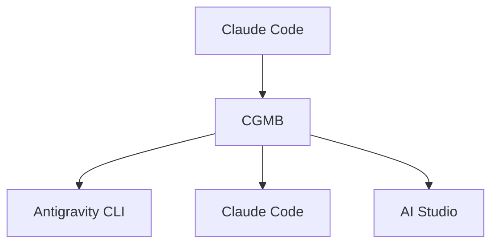

<div align="center">

# 🌉 Claude-Gemini Multimodal Bridge

### *AIの力を、ひとつに。*

**Claude Code、Antigravity CLI、Google AI Studioをシームレスに統合するMCPブリッジ**

[🇺🇸 English](README.md) • [📦 NPM](https://www.npmjs.com/package/claude-gemini-multimodal-bridge) • [🐛 Issues](https://github.com/goodaymmm/claude-gemini-multimodal-bridge/issues)

---

[](https://www.npmjs.com/package/claude-gemini-multimodal-bridge)
[](https://opensource.org/licenses/MIT)
[](https://nodejs.org/)
[](https://www.typescriptlang.org/)

[](https://modelcontextprotocol.io/)
[](https://ai.google.dev/)
[](https://www.anthropic.com/)
[](https://github.com/sponsors/goodaymmm)

[](#-windows環境)
[](#-クイックスタート)
[](#-クイックスタート)

</div>

---

## 🤔 なぜ CGMB？

<table>
<tr>
<td width="33%" align="center">

### 🔄 マルチモデルオーケストレーション

Claude の**推論力**、Antigravity CLI の**検索力**、AI Studio の**生成力**を最適に統合。2026年のAIトレンド「専門AIの協調」を先取り

</td>
<td width="33%" align="center">

### ⚡ インストール1回、セットアップ2手順

`npm install -g` で MCP 統合まで完了。その後 `agy` の導入と AI Studio API キーの設定が必要です

</td>
<td width="33%" align="center">

### 🎯 MCP標準対応

Anthropic Model Context Protocol準拠。234件のテストを Linux / Windows / macOS の CI で push ごとに実行

</td>
</tr>
</table>

---

## ✨ v1.3.0 の変更

Google は 2026-09-18 以降、Gemini 2.5 系モデルをそれ以前から利用していた
アカウントにしか提供しておらず、新しい API キーでは AI Studio レイヤーが何も
返せませんでした。このリリースでは AI Studio の既定モデルを Gemini 2.5 から移し、
テキストを含む PDF をアップロードせずローカルで読む PDF モードを追加し、Node.js
の下限を 22.12.0 に引き上げます。いずれも実際の Gemini API・実際の `agy` では
実行していません（バージョン履歴を参照）。

| 変更 | 説明 |
|------|------|
| 🚀 **AI Studio の既定モデルを Gemini 2.5 から移行** | 汎用・ドキュメント・マルチモーダルは `gemini-3.5-flash-lite`（2.5 Flash と同価格）、画像は `gemini-3.1-flash-lite-image`、音声は `gemini-3.8-flash-tts` |
| 🔑 **新しい API キーを壊れていると判定しなくなりました** | キー確認に、新しいキーを拒否する `gemini-2.5-flash` を使っていました |
| 🎵 **音声ファイルの WAV ヘッダーは 1 つだけ** | 3.8 TTS は完全な WAV ファイルを返すため、ヘッダーを重ねて付けずそのまま書き出します |
| 📄 **テキストを含む PDF はローカルで読み取り** | テキストとして Gemini へ送り、アップロードするのはスキャン PDF だけです。新しい既定は `auto` で、`--pdf-mode upload` で従来の動作に戻せます |
| 🔐 **Antigravity のサインイン確認が実際のリクエストと一致** | `agy` に `GEMINI_API_KEY` を渡さず、API キーをサインインとみなさなくなりました。期限切れのサインインは未サインインと判定します |
| 🧭 **表記を Antigravity CLI に統一** | 残っていた「Gemini CLI」の案内を `agy` に修正。`cgmb detect-paths --fix` が一度も出なかった `agy` のインストール案内を表示します |
| 📦 **依存パッケージを現行メジャーへ更新** | `@google/genai` 2、commander 15、dotenv 18、pdf-parse 2、zod 4。Node.js ≥ 22.12.0。余分な CLI 引数はエラーになるため、プロンプトは引用符で囲みます |
| 📌 **lockfile をコミット** | `package-lock.json` をリポジトリに含めました。CI の `npm ci` への切り替えはまだです |

### v1.2.2 の変更

整理のみのリリースです。利用者から到達できる挙動は何も変わりません
（削除したコードはいずれも到達不能でした）。

| 変更 | 説明 |
|------|------|
| 🧹 **到達不能な 4 経路を削除** | サーバに実装のない MCP ツールを呼んでいました。現在は到達不能ですが、`--script` も同じ状態からでした |
| 🗑️ **未使用モジュール 740 行を削除** | `PromptOptimizer` と `quotaMonitor`。参照ゼロのまま同梱されていました |
| 🔒 **レイヤーとサーバの突き合わせを自動化** | サーバを起動して実装ツールを問い合わせ、レイヤーがそれ以外を名指しできる場合に失敗するテストを追加 |

### v1.2.1 の修正

| 修正 | 説明 |
|------|------|
| 🎯 **応答が依頼した呼び出し元へ届く** | AI Studio への並行リクエストが互いの応答を受け取っていました |
| 🚪 **`cgmb` が処理後に終了する** | 共有 MCP サーバを起動したまま放置せず、確実に終了させます |
| 🔑 **`.env` は自分のプロジェクトから読む** | インストール先や `~/.cgmb` は既定では読まず、`CGMB_ENV_PATH` で明示指定 |
| 🔍 **検索キャッシュが尋ねた質問に答える** | 年違い・モデル違いを同一エントリとして扱わなくなりました |
| 🧩 **ワークフローの各ステップが入力を受け取る** | parallel が出力を publish し、hybrid が `dependsOn` の順序を守ります |

---

## 🏗️ アーキテクチャ



| レイヤー | 得意分野 | タイムアウト |
|:--------:|:---------|:-----------:|
| 🔍 Antigravity CLI (`agy`) | Web検索、リアルタイム情報 | 90秒 |
| 🧠 Claude Code | 複雑な推論、コード分析 | 300秒 |
| 🎨 AI Studio | 画像生成、音声合成、OCR | 300秒 |

---

## 🚀 クイックスタート

### 📋 前提条件

- **Node.js** ≥ 22.12.0
- **Claude Code CLI** インストール済み
- **Antigravity CLI** (`agy`) 1.1.7 以上 — 別途インストールが必要（下記参照）

### 📦 インストール

```bash
npm install -g claude-gemini-multimodal-bridge
```

> 💡 postinstallスクリプトが自動で:
> - Antigravity CLI の有無を確認し、未導入ならインストール手順を表示
> - Claude Code MCP統合をセットアップ
> - `.env` テンプレートを作成
> - システム要件を検証

### 🔑 環境設定

作業ディレクトリに `.env` ファイルを作成:

```bash
AI_STUDIO_API_KEY=your_api_key_here
```

🔗 APIキー取得: https://aistudio.google.com/app/apikey

### 🎯 Antigravity CLI のセットアップ

Google は 2026-06-18 に Gemini CLI の個人向け提供を終了しました。検索レイヤーは
後継の Antigravity CLI (`agy`) で動作します。npm では配布されていないため、
別途インストールしてください:

```bash
# Windows (PowerShell)
irm https://antigravity.google/cli/install.ps1 | iex

# macOS / Linux
curl -fsSL https://antigravity.google/cli/install.sh | bash
```

インストール後、一度だけ起動してサインインします。ブラウザが開き、OAuth トークンは
OS のキーリングに保存されます。API キーも `agy auth` サブコマンドも存在しません:

```bash
agy
```

`agy models` で確認できます。CGMB は **agy 1.1.7 以上**が必要です
（それ以前のビルドは stdout が端末でない場合に何も出力しません）。

### 💬 Claude Code で使い始める

```
NPMでCGMBをインストールしたので、今の環境からcgmbコマンドを探してください。使い方も教えてください。
```

---

## 💡 使用例

CGMBはClaude Codeとシームレスに統合。**「CGMB」キーワード**を使うだけ:

```bash
# 🎨 画像生成
"CGMBで未来都市のイメージを生成してください"

# 📄 ドキュメント分析（絶対パスを使用）
"CGMBで/full/path/to/report.pdfにあるこの文書を分析してください"

# 🌐 URL分析
"CGMBでhttps://example.com/document.pdfを分析してください"

# 🔍 Web検索
"CGMBで最新のAI情報を検索してください"

# 🎵 音声生成
"CGMBで「ポッドキャストへようこそ」という音声を作成してください"

# 📝 OCR対応PDF解析
"CGMBでこのスキャンされたPDF文書をOCRで解析してください"
```

### 🔄 自動ルーティング

1. Claude Code リクエストに **「CGMB」** を含める
2. CGMB が最適な AI レイヤーに自動ルーティング:
   - **🔍 Antigravity CLI**: Web検索、最新情報
   - **🎨 AI Studio**: 画像、音声、ファイル処理
   - **🧠 Claude Code**: 複雑な推論、コード分析

---

## 🤖 使用モデル一覧

| 用途 | モデルID | レイヤー |
|:----:|:---------|:-------:|
| 🔍 Web検索 | `gemini-3.6-flash-low` | Antigravity CLI |
| 🎨 画像生成 | `gemini-3.1-flash-lite-image` | AI Studio |
| 🖼️ 画像生成（高品質） | `gemini-3-pro-image` | AI Studio |
| 🎵 音声生成 | `gemini-3.8-flash-tts` | AI Studio |
| 📄 ドキュメント処理 | `gemini-3.5-flash-lite` | AI Studio |
| 📝 OCR/テキスト抽出 | `gemini-3.5-flash-lite` | AI Studio |
| 🔮 汎用マルチモーダル | `gemini-3.5-flash-lite` | AI Studio |

Antigravity の行は既定値です。どの Antigravity モデル ID が有効かは手元の
`agy models` が決めます。一覧はアカウントとプランによって異なります（agy 1.2.16
で報告された一覧には `gemini-3.6` / `3.7` / `3.8` の Flash 各段階
`-low` / `-medium` / `-high` があります）。別のモデルは `ANTIGRAVITY_MODEL` または
`--model` で指定します。AI Studio 側の ID は `src/core/types.ts` の `AI_MODELS` に
あります。

---

## 📈 パフォーマンス

ベンチマーク値ではなく、実装が実際に行っていることです:

| 仕組み | 効く場面 | 調整 |
|--------|----------|------|
| 検索結果キャッシュ | 同じ Web 検索プロンプトの繰り返し | `ENABLE_CACHING` / `CACHE_TTL` / `MAX_CACHE_ENTRIES` |
| 認証キャッシュ | `agy` と Claude Code の認証確認を毎回ではなく数時間単位で | — |
| レイヤーの遅延初期化 | 起動時ではなく最初の利用時にレイヤーを起動 | — |
| 指数バックオフ付きリトライ | API や CLI の一時的な失敗 | `MAX_RETRIES` / `RETRY_DELAY` |

実際の速度はどのレイヤーが応答するかと上流 API に依存するため、固定の数値は
掲げていません。

---

## 📄 PDF処理 & OCR

### ✨ OCR機能

- ✅ テキストベースとスキャンPDF両対応
- ✅ OCR必要性を自動検出（まずローカルでテキストを抽出）
- ✅ スキャンPDFは Gemini File APIでネイティブOCR処理
- ✅ 多言語サポート

### 📋 処理ワークフロー

```
PDF入力 → ローカルでテキスト抽出 ─┬─ テキストあり           → テキストを Gemini へ送信 → 結果出力
                                  └─ スキャン/テキストなし → アップロード → OCR       → 結果出力
```

空白を除いて 100 文字以上のテキストがあるページをテキストページとみなし、5 ページ中 4 ページ
以上がテキストページの PDF はテキストで送ります。アップロードより安く待ち時間も
ありませんが、Gemini に届くのは文字だけで、図・グラフ・レイアウトは届きません。
ページそのものを見せたい場合はアップロードを指定してください:

| モード | 動作 | 指定方法 |
|--------|------|----------|
| `auto`（既定） | テキストがあればローカル抽出、なければアップロード | — |
| `local` | 常にローカル抽出。テキストのない PDF はエラー | `--pdf-mode local` |
| `upload` | 常にアップロード（1.2.2 までの動作） | `--pdf-mode upload` |

`--pdf-mode` は `analyze`・`multimodal`・`process`・`aistudio` で使えます。MCP
からは `options.pdf_mode` で指定します。既定は `CGMB_PDF_MODE`、ページあたりの
しきい値は `CGMB_PDF_TEXT_MIN_CHARS` で変更できます。PDF の URL は常にアップロード
されます。

### 📁 サポート形式

- テキストベースPDF
- スキャンPDF（OCR処理）
- 画像ベースPDF（OCR変換）
- 混合コンテンツ
- 複雑なレイアウト（表、グラフ、フォーマット済みコンテンツ）

---

## 📂 ファイル構成

生成されたコンテンツは自動的に整理:

```
output/
├── images/     # 🎨 生成された画像
├── audio/      # 🎵 生成された音声ファイル
└── documents/  # 📄 処理されたドキュメント
```

ファイルは CGMB を実行した作業ディレクトリ配下に書き出され、生成された
ファイルのパスは応答に含まれます。

CGMB が Claude Code に公開する MCP ツールは `cgmb`、
`cgmb_get_layer_requirements`、`cgmb_document_analysis`、
`cgmb_multimodal_process`、`cgmb_workflow_orchestration` の5つです。

---

## 🔧 設定

### 環境変数

```bash
# 必須
AI_STUDIO_API_KEY=your_api_key_here

# 検索レイヤー (Antigravity CLI)
ANTIGRAVITY_MODEL=gemini-3.6-flash-low   # `agy models` に存在するもののみ
ANTIGRAVITY_TIMEOUT=90000                # 1回あたりのタイムアウト (ms)
ANTIGRAVITY_CLI_PATH=                    # 未設定なら自動検出

# Claude レイヤー
CLAUDE_CODE_PATH=/usr/local/bin/claude   # 既定の場所以外にある場合

# PDF: auto | local | upload（「PDF処理 & OCR」を参照）
CGMB_PDF_MODE=auto
CGMB_PDF_TEXT_MIN_CHARS=100

# キャッシュ・ログ
ENABLE_CACHING=true
CACHE_TTL=3600
LOG_LEVEL=info

# AI_STUDIO_API_KEY の非推奨フォールバック（前者を推奨）
GEMINI_API_KEY=your_api_key_here
```

### 🔐 Google へ送信してよいファイルの範囲

AI Studio レイヤーはファイルの内容を Google へアップロードするため、CGMB を
起動したディレクトリからしか読み取りません。それ以外の場所のファイルを扱う
場合は、対象ディレクトリを明示してください:

```bash
# 区切りは Windows が ";"、それ以外は ":"
CGMB_ALLOWED_ROOTS=C:\Users\me\Documents;D:\shared
```

### 📍 `.env` をどこから読むか

CGMB は実行したディレクトリの `.env` を読みます。1.2.0 までは CGMB 自身の
インストールディレクトリ、グローバル npm ディレクトリ、`~/.cgmb` も読んでいたため、
そこに置いた 1 つのファイルがマシン上のすべてのプロジェクトに適用されていました。
`AI_STUDIO_API_KEY` だけでなく、上記の境界を決める `CGMB_ALLOWED_ROOTS` まで
一緒に効いてしまいます。1.2.1 以降、これらの場所は明示指定が必要です:

```bash
# ファイル、またはそれを含むディレクトリ。作業ディレクトリより先に参照されます
CGMB_ENV_PATH=/home/me/.cgmb/.env
```

**1.2.0 以前からのアップグレード時**: 鍵を上記のいずれかに置いていた場合は、
この変数で指定してください。指定しないと鍵が見つからないと報告されます。

全一覧は `.env.example` にあります。パースされるだけで誰も読まない項目も
明記してあるので、設定が効くかどうかは先にそちらを確認してください。

### MCP統合

CGMBは自動的にClaude Code MCP統合を設定:
- 📍 設定パス: `~/.claude-code/mcp_servers.json`
- ⚡ 直接Node.js実行
- 🔒 既存サーバーを上書きしない安全なマージ

---

## 🪟 Windows環境

CGMB は v1.1.0 以降 Windows 環境を**完全サポート**しています:

| 機能 | 状態 |
|------|:----:|
| CLI | ✅ すべてのコマンドが動作 |
| MCP統合 | ✅ MCPツール呼び出しが正常動作 |
| パス解決 | ✅ `C:\path\to\file` 形式を自動処理 |
| Antigravity CLI | ✅ Windows版との完全な互換性 |

```powershell
# パスは絶対パスを推奨
cgmb analyze "C:\Users\name\Documents\report.pdf"

# 環境変数の設定（PowerShell）
$env:AI_STUDIO_API_KEY = "your_api_key_here"

# 環境変数の設定（コマンドプロンプト）
set AI_STUDIO_API_KEY=your_api_key_here
```

---

## 🐧 Linux / WSL環境

CGMBはLinuxおよびWSL環境で**完全に動作**:

| 機能 | 状態 |
|------|:----:|
| CLI | ✅ すべてのコマンドが動作 |
| MCP統合 | ✅ MCPツール呼び出しが正常動作 |
| パス解決 | ✅ `/mnt/` WSLパス、Unixパス対応 |
| Antigravity CLI | ✅ Linux版との完全な互換性 |

```bash
# Unixパス形式で使用
cgmb analyze /home/user/documents/report.pdf

# WSL環境での例
cgmb analyze /mnt/c/Users/name/Documents/report.pdf

# 環境変数の設定
export AI_STUDIO_API_KEY="your_api_key_here"
export ANTIGRAVITY_MODEL="gemini-3.6-flash-low"
```

### WSLでのテスト実行

テストはプラットフォームを判別し、両環境で同数のケースを実行します。Windows専用の
ケース（`.cmd` シムの扱い）にはPOSIX版が対になっており、POSIX専用のケース
（シグナルによる終了、`/mnt/c/Users` の探索）はWindowsではスキップされます。

```bash
cd /mnt/<drive>/path/to/claude-gemini-multimodal-bridge
node --version        # engines.node (>= 22) を満たすこと
npm run build         # ホスト側でビルド済みならそれを流用してもよい
node --test "tests/**/*.test.mjs"
```

---

## 🔍 トラブルシューティング

### デバッグモード

```bash
export CGMB_DEBUG=true
export LOG_LEVEL=debug
cgmb serve --debug
```

### OCRとPDF処理の問題

**OCR結果が不正確な場合:**
- 高解像度スキャンPDF（300+ DPI）を使用
- 明瞭で高コントラストなテキストを確保
- 傾きや回転した文書を避ける

**大きな文書でタイムアウトする場合:**
- テキストのある PDF はローカルで読み取られ、アップロードされません。
  `--pdf-mode local` で確実にそうできます
- 処理前に大きなPDFを分割（制限: 50MB、1,000ページ）
- AI Studio レイヤーの 300 秒は固定で、延長する環境変数はありません。
  分割が唯一の対処です

---

## 💰 APIコスト

CGMBは従量課金制APIを使用:
- 📊 [Google AI Studio API 料金詳細](https://ai.google.dev/pricing)

---

## 📁 プロジェクト構造

```
src/
├── core/           # 🎯 メインMCPサーバーとレイヤー管理
├── layers/         # 🔌 AIレイヤー実装
├── auth/           # 🔐 認証システム
├── tools/          # 🛠️ 処理ツール
├── utils/          # 🔧 ユーティリティとヘルパー
└── mcp-servers/    # 🌐 カスタムMCPサーバー
```

---

## 🔗 リンク

<table>
<tr>
<td>

### 📦 プロジェクト
- [GitHub](https://github.com/goodaymmm/claude-gemini-multimodal-bridge)
- [NPM](https://www.npmjs.com/package/claude-gemini-multimodal-bridge)
- [Issues](https://github.com/goodaymmm/claude-gemini-multimodal-bridge/issues)

</td>
<td>

### 🔧 関連ツール
- [Claude Code](https://docs.anthropic.com/en/docs/claude-code)
- [Antigravity CLI](https://antigravity.google/docs/cli)
- [Google AI Studio](https://aistudio.google.com/)
- [MCP](https://modelcontextprotocol.io/)

</td>
<td>

### 📜 利用規約
- [Google AI Studio](https://ai.google.dev/gemini-api/terms)
- [Claude](https://www.anthropic.com/terms)
- [Gemini API](https://ai.google.dev/gemini-api/docs/safety-guidance)

</td>
</tr>
</table>

---

## 📜 バージョン履歴

### v1.3.0 (2026-10-11)

修正のみの 1.2.3 として準備していましたが、マイナーリリースとして公開します。
修正に加えて PDF モードを追加し、既定の動作を 1 つ変え（テキストを含む PDF は
アップロードしなくなります）、Node.js の下限を 22.12.0 に引き上げ、ランタイム依存
5 つをメジャー更新したためです。1.2.3 は公開していません。

- 🔑 **新しい AI Studio API キーで動作するようになりました**: Google は 2026-09-18 に
  Gemini 2.5 系モデルを、それ以前から利用していたアカウントに限定しました。非推奨では
  ありませんが、新しい API キーは拒否されます。`gemini-2.5-flash` は CGMB の汎用・
  ドキュメント処理・マルチモーダル分析の既定モデルであり、キー確認に使うモデルでも
  あったため、有効な新しいキーがリクエスト前の段階で壊れていると報告されていました。
  既定を新しいキーで使えるモデルへ移します:
  - `gemini-2.5-flash` → `gemini-3.5-flash-lite`（汎用・ドキュメント処理・
    マルチモーダル分析）。コンテキスト 1M トークン、料金 1M トークンあたり
    $0.30 / $2.50 とも同じで、請求額は変わりません
  - `gemini-2.5-flash-image` → `gemini-3.1-flash-lite-image`。Google が後継として
    名指しするモデルで、1 枚あたり約 $0.034、出力は 1K 解像度までです
  - `gemini-3.1-flash-tts-preview` → `gemini-3.8-flash-tts`。旧 ID はレガシーの
    プレビュー扱いになりました
  - `gemini-3-pro-preview` → `gemini-3.1-pro-preview`。旧 ID は 2026-03-09 に
    提供終了し、別名としてのみ残っています
- 🎵 **音声ファイルに WAV ヘッダーを二重に付けなくなりました**: 3.8 TTS は、従来の
  モデルが返していたヘッダーなしの PCM ではなく完全な WAV ファイルを返します。
  WAV ヘッダーを付けていた 2 箇所は、いずれもヘッダーを重ねるところでした。WAV は
  そのまま書き出し、上書き指定で選んだ旧 TTS モデルの PCM は従来どおりヘッダーを
  付けます。報告するサンプルレートとビット深度も、想定値ではなく音声の実際の値です
- 🔒 **モデル ID が再びずれないように**: `src/` 内のモデル ID はすべて `AI_MODELS`
  から取るようにし、`gemini-2.5-*` の直書きがあれば失敗するテストを追加しました
  （`gemini-2.0-*` は従来から検出しています）。設定スキーマの `gemini.model` の
  既定値はまだ `gemini-2.5-pro` でしたが、同じ定数に従うようにしました
- 🔐 **Antigravity のサインイン確認が実際のリクエストと同じ環境で行われます**: 確認は
  環境変数をすべて引き継いで `agy models` を実行していた一方、レイヤーは `agy -p` に
  `GEMINI_API_KEY` を含まない最小限の許可リストだけを渡していました。agy はこのキーを
  API キーモードの要求とみなすため、キーが設定されていると（CGMB 自身の `.env`
  テンプレートが設定します）、確認は「サインイン済み」と答えながら実際のリクエストは
  空のキーリングで実行される、ということが起きえました。両者は同じ許可リストを使う
  ようになり、CGMB の秘密情報は `agy` に渡りません
- ⏳ **期限切れのサインインを未サインインと判定します**: agy 1.3.1 以降、期限切れ・
  失効したサインインでは "Authentication expired. Please log back in." と表示され、
  これが障害と判定されることがありました。未サインインとして報告し、エラーで
  `agy` を再度実行するよう案内します
- 🔐 **Gemini API キーを Antigravity のサインインとみなさなくなりました**: サインインの
  案内とトークン更新は、`GEMINI_API_KEY` か `GOOGLE_API_KEY` が設定されていれば確認を
  実行せずに `agy` をサインイン済みと報告していました。インストーラーが新しい `.env`
  に書き込むプレースホルダーでも条件を満たすため、キーリングが空のまま新規インストール
  がサインイン済みと案内されていました。判定は確認の結果だけに基づき、メッセージも
  それに従います。未サインインなら `agy` の実行を、未インストールならインストール
  コマンドを案内し、時間内に応答しない `agy` はサインイン失敗ではなく不明と報告します。
  セットアップウィザードは、サインインに成功すると以前の「未サインイン」の結果を
  忘れます。公開メソッドの名前は変えておらず、AI Studio は従来どおり独自の経路で
  `AI_STUDIO_API_KEY` を読みます
- 📋 **Antigravity のモデル一覧を更新**: 参照用の一覧を、agy 1.2.16 で報告された
  `agy models` の出力に差し替えました — Gemini 3.6 / 3.7 / 3.8 Flash の各段階、
  3.1 Pro、Claude Opus / Sonnet 5.5 の各段階、`gpt-oss-120b-medium`。参考情報であり、
  この一覧を理由に拒否されるモデルはありません。有効かどうかは手元の `agy models` が
  決めます
- 🧭 **「Gemini CLI」表記を置き換え**: CLI の案内、起動時のヒント、依存関係チェック、
  ログが Antigravity CLI (`agy`) を名指しするようになりました。うち 1 件は欠陥で、
  `cgmb detect-paths --fix` が旧名と比較していたため `agy` のインストール案内が一度も
  表示されていませんでした。`detect-paths` は `ANTIGRAVITY_CLI_PATH` も表示します
- 📄 **テキストを含む PDF はローカルで読み取ります（既定の変更）**: 1.1.0 以降、PDF を
  扱う経路（`cgmb analyze`・`multimodal`・`process`・`aistudio -f` と 3 つの MCP
  ツール）はすべて Gemini File API でファイルをアップロードしており、コードに残って
  いたローカルのテキスト抽出には呼び出し元がありませんでした。ローカルの PDF はまず
  読み取り、80 % 以上のページに空白を除いて 100 文字以上のテキストがあれば、ファイル
  の代わりにテキストを Gemini へ送ります。アップロードより安く、待ち時間もありません。
  スキャン PDF や画像だけの PDF は従来どおりアップロードして Gemini に OCR させ、PDF
  の URL は常にアップロードします。これは意図した挙動の変更で、テキストを含む PDF
  では図・グラフ・レイアウトが Gemini に届かなくなります。モードは `analyze`・
  `multimodal`・`process`・`aistudio` の `--pdf-mode auto|local|upload`、MCP からは
  `options.pdf_mode` で指定し、既定は `CGMB_PDF_MODE`、ページあたりのしきい値は
  `CGMB_PDF_TEXT_MIN_CHARS` で変更できます。`upload` で 1.2.2 の動作に戻り、`local`
  はテキストのない PDF をエラーにし、不正な値は拒否します。判定は stderr のログ、
  `metadata.pdfs` に残り、CLI は PDF ごとに 1 行表示します。どこからも import されて
  いなかった `DocumentAnalysis`（1,029 行）は削除しました
- 🧹 **到達不能なコードをさらに 2 つ削除**: `WorkflowOrchestrator`（1,004 行。どこからも
  import されていなかった 2 つ目のワークフローエンジン）と
  `AIStudioLayer.processDocuments()`（呼び出し元なし。仮に呼ばれても、サーバがパス
  文字列を期待する箇所にオブジェクトを渡すため全文書が読み飛ばされ、成功を返して
  いました）、および未使用の `selectOptimalModel` / `getModelConfig`。削除は先に
  分離環境で試行して計測しました: 3 つのエントリポイントから到達できるモジュール、
  両サーバの `tools/list`、CLI の全 `--help` 画面、ルートの export はいずれも不変です。
  `dist/tools/workflowOrchestrator.js` は 1.2.2 の `PromptOptimizer` と同様に公開
  されなくなり、`processDocuments` は公開型 `AIStudioLayer` から消えます
- 📦 **ランタイム依存を現行メジャーへ更新**: `@google/genai` 1.52 → 2.28、commander
  11 → 15、dotenv 16 → 18、pdf-parse 1 → 2、zod 3 → 4。1 つずつ更新し、そのたびに
  テスト全体を実行しました。commander 15 と pdf-parse 2 が Node.js 22.12.0 を必要と
  するため、下限を 22.0.0 から **≥ 22.12.0** に引き上げます。利用者から見える変化:
  - dotenv 17 以降は読み込みのたびに 1 行表示し、18 は `DOTENV_*` 環境変数を読んで
    デバッグ出力を stdout に出します。stdout は MCP サーバが JSON-RPC を流す経路です。
    CGMB のローダーはすべてのオプションを dotenv 16 と同じ値に固定しているため、
    `DOTENV_*` に何が設定されていても `.env` の読み込みで stdout には何も出ません。
    テストでこれを確認しています
  - commander 13 で余分な引数がエラーになり、これはそのまま有効にしています。引用符
    なしの `cgmb generate-image a red fox` は "a" の画像を生成して課金していましたが、
    今後は拒否されます。複数語のプロンプトは引用符で囲んでください
  - pdf-parse 2 は API が異なります。旧来の 2 箇所の呼び出しを置き換えた 1 つの関数は、
    記載している上限（50MB / 1,000 ページ）を超える PDF を全体を読む前に拒否します

  変わらないもの: MCP ツールのスキーマは手書きの JSON で、両サーバの `tools/list` の
  出力は更新の前後でバイト単位まで同一です。zod スキーマ 58 個はいずれも zod 4 でも
  同じ入力を受け付け・拒否し、違うのは検証エラーの文言だけです。`@google/genai` 2 の
  変更は Interactions API のみで、偽のエンドポイントへ送るリクエストは 1.52 と 2.28
  で同一でした
- 🧰 **lint を ESLint 10 と typescript-eslint 8 へ、内容はそのまま**: ESLint 8 は
  サポートが終了しており、typescript-eslint 6 は TypeScript 5.9 に対応していません
  でした。ルールは同じ 14 個・同じ重大度で、プリセットは取り込んでいません。lint
  スクリプトは Linux と macOS で `src/cli.ts` と `src/index.ts` を検査していません
  でした。引用符のない glob をシェルが展開していたためです。glob を引用符で囲み、
  どのプラットフォームでも同じファイルを検査するようにしました。警告数が 127 → 131
  に増えたのはこのためだけです。rimraf は 6、`@types/node` は 22 系に更新し、
  TypeScript は 5.9 のままです
- 🧹 **古いバージョン表記・固定モデル・lockfile**: `package.json` の `mcp` ブロックは
  v1.2.0 のままでしたが 1.3.0 にしました。GitHub Pages のランディングページ
  (`docs/index.html`) は v1.1.0 のままで Gemini CLI を説明していました。
  `.claude/settings.json` はヘッドレスの Claude Code プロセスにレガシーの
  `claude-sonnet-5` を固定していましたが、`claude-sonnet-5-5` に変更しました。
  `package-lock.json` は gitignore されていたため、CI は実行のたびにバージョン範囲を
  解決し直し、3 つのプラットフォームが別々の依存ツリーをテストしうる状態でした。
  pdf-parse 2 が Windows と macOS で取り込むプラットフォーム別パッケージも含めて
  コミットしました。CI のインストール手順を `npm ci` に切り替える作業は未実施です

**変更なし**: 高品質な画像生成の `gemini-3-pro-image`、Antigravity の既定
`gemini-3.6-flash-low`、`MIN_AGY_VERSION`（1.1.7）。export している識別子の名前は
変えていません。テスト: 179 → 234（WAV ヘルパー 7 件、スキーマ既定値 1 件、
モデル表 2 件、Antigravity の確認と環境 8 件、API キーとサインイン 3 件、依存の
更新 10 件、PDF モード 24 件）。Linux では 232 件が成功し、2 件はスキップです。

**実環境では未検証**: いずれも実際の Gemini API・実際の `agy` やキーリングに対しては
実行していません。セットアップウィザードは対話的にではなく、ウィザードが呼ぶ
メソッドを通して確認しました。モデル ID と 3.8 TTS の WAV 出力は Google の
ドキュメントとリリースノート、agy 1.3.1 の文言と 1.2.16 のモデル一覧はリリース
ノートとコード中で引用している GitHub issue に基づいています。PDF のテストは手作りの
PDF と偽の Gemini エンドポイントを使っています。実際の文書・スキャン PDF・日本語の
PDF では試しておらず、80 % / 100 文字のしきい値は測定ではなく推論で決めたもので、
新しい PDF のテストは Windows ではまだ実行していません。

### v1.2.2 (2026-08-03)

整理のみのリリースです。利用者から到達できる挙動は何も変わりません。
削除したものはいずれも到達不能でした。

- 🧹 **到達不能な 4 経路を削除**: レイヤーは 9 つの MCP ツールを名指ししますが、
  サーバの実装は 8 つで、重なるのは 5 つでした。`analyze_audio_advanced` /
  `convert_file` / `convert_pdf` / `transcribe_audio` はサーバに存在したことがなく、
  呼べば `MCP error -32601` を返します。到達手段はありません —
  `task.type` に `'convert'` や `'audio_analysis_advanced'` を設定するコードはどこにもなく、
  `taskType` は MCP ツールのスキーマに無く、うち 2 つは呼び出し元自体がありませんでした。
  これは `generate_text` が `generate-audio --script` という入口を得て
  実害のある欠陥になる前とまったく同じ状態です。入口が付くのを待たせず削除しました
- 🔒 **レイヤーとサーバの突き合わせを自動化**: MCP サーバを起動して `tools/list` を問い合わせ、
  レイヤーがそこに無いツールを名指しできる場合に失敗するテストを追加しました。
  本リリース前は上記 4 件を検出します
- 🗑️ **未使用モジュール 740 行を削除**: `PromptOptimizer` と `quotaMonitor`。
  自身以外からの参照がなく、パッケージのエントリポイントからも export されていないまま
  `dist` に含まれて公開されていました
- 1.2.1 で「既知・未修正」としていた `analyze_audio_advanced` は 1 点目で解消しました

`AudioAnalysisResult` は `core/types.js` から引き続き export されます。
返していたメソッドは無くなりましたが、型自体は公開されている面の一部であり、
パッチリリースで落とすのは筋が悪いためです。

### v1.2.1 (2026-08-02)

修正のみのリリースです。すべて 1.2.0 で実測された欠陥への対応で、機能追加は
ありません。コードとテストで 18 ファイルに収まっています。

- 🎯 **AI Studio への並行リクエストが互いの応答を取らなくなりました**: 共有 MCP
  サーバに対して呼び出しごとに stdout リスナーを足し、最初に見えた応答で確定して
  いたため、2 つの呼び出しが同じ応答を受け取っていました。リクエスト ID も
  `Date.now()` で、同一ミリ秒の 2 件は衝突します。ID で応答を振り分け、ID は単調に
  なり、TTL で交代したプロセスが後任を巻き込んで失敗させることもなくなりました
- 🚪 **AI Studio 利用後に `cgmb` が終了します**: 共有 MCP サーバを終了する手段が
  なく、その stdio パイプが親プロセスを生かし続けていました。shutdown で確実に
  終了させ、さらに shell を経由せずに起動するため、終了処理が中間の shell ではなく
  サーバ本体に届きます
- 🔑 **`.env` はインストール先ではなくプロジェクトから読みます**: 既定でインストール
  ディレクトリ・グローバル npm ディレクトリ・`~/.cgmb` を読んでいました。他プロジェクト
  の `AI_STUDIO_API_KEY` に加え、**Google へ送ってよいファイルを決める
  `CGMB_ALLOWED_ROOTS`** まで引き込む点がより深刻です。これらは `CGMB_ENV_PATH` に
  よる明示指定のみとし、同変数はファイル・ディレクトリのどちらも受け付け、既定の
  探索先より優先されます
- 🔍 **検索キャッシュが尋ねた質問に答えます**: キーが 2024〜2029 年をすべて同一視し、
  「最新」「最近」「新しい」を畳み込み、モデルを含めていませんでした。2026 年の質問に
  2024 年の回答が返る、別モデルの回答が返る、といった誤りが起きていました
- 🧩 **ワークフローの各ステップが入力を受け取ります**: parallel が出力を publish せず、
  下流ステップが参照先の値なしで動いたうえ success を返していました。hybrid は
  `dependsOn` の順序を無視していました
- ⏱️ **タイムアウトが実際の処理量を反映します**: Claude の一般経路がレイヤー既定を
  下回る固定値を下限にし、見積りも実際に送るプロンプトを見ていませんでした
- 🔊 **提供終了モデル ID を除去**: 音声経路に `gemini-2.0-flash` が直書きされていました
- 🧪 **CI がテスト全体を実行します**: postinstall スクリプトが CI 環境でモジュール
  スコープから `process.exit(0)` していたため、これを `require` したプロセスごと
  終了していました。GitHub Actions 上でテスト 5 件が消えたまま緑になっていました

**削除**: `generate-audio --script`。「原稿を生成してから読み上げる」2 段階処理を
うたっていましたが、第 1 段が AI Studio サーバに存在しない `generate_text` ツールを
要求するため、本バージョン以前のすべてで `MCP error -32601` を返していました。
`--help` にのみ現れ、本 README にも `docs/` にも記載はありません。通常の
`generate-audio` は影響を受けません。2 段階処理は、検証できるリリースで作り直します。

**既知・未修正**: `audio_analysis_advanced` タスク種別が、サーバに実装のない
`analyze_audio_advanced` を呼びます。CLI からも MCP ツールからも到達できないため、
現状これを起動する手段はありません。

### v1.2.0 (2026-07-28)
- 🔄 **Antigravity CLI へ移行**: Google が 2026-06-18 に Gemini CLI の個人向け提供を
  終了したため、Web検索レイヤーは `agy` (Antigravity CLI 1.1.7 以降) を呼びます。
  認証は API キーではなく OS キーリング経由です。レイヤー名は `antigravity` が正準で、
  `gemini` も別名として引き続き使えます
- 🚀 **AI Studio モデル更新**: 高品質な画像生成に `gemini-3-pro-image`、音声生成に
  `gemini-3.1-flash-tts-preview` を採用。提供終了した `gemini-2.0-flash-exp` は
  直書きされていた6箇所すべてから除去しました
- 🖥️ **3OS 対応**: Linux / Windows / macOS を push ごとに CI で検証しています
- 🎯 **`targetLayer` が機能するように**: レイヤーを指定すればそこへ届きます。`claude`
  も指定可能になり、指定したのに別レイヤーが応答する挙動を修正しました
- 🔧 **`CLAUDE_CODE_PATH` が有効に**: 環境変数と `claude.code_path` が実行ファイルの
  探索に届くようになり、既定の場所以外のインストールも使えます
- 🧹 **デッドコード削除**: どこからも import されていなかったワークフロークラス
  3,619行を削除。公開 API の表面に変更はありません

### v1.1.0 (2026-01-10)
- 🪟 **Windows完全対応**: CLI/MCP両方でWindowsをネイティブサポート
- 📝 **OCR機能強化**: 画像ベースPDFの自動OCR処理
- 🚀 **Gemini最新モデル**: gemini-2.5-flash 対応
- ⚡ **MCP統合改善**: 非同期レイヤー初期化の最適化
- 📈 **パフォーマンス向上**: タイムアウト短縮、遅延読み込み、キャッシング強化
- 🛡️ **エラー回復**: 指数バックオフによる95%の自己修復率

### v1.0.4
- 🎉 初期リリース
- 🏗️ 3層アーキテクチャ実装
- 🎨 基本的なマルチモーダル処理

---

<div align="center">

## 📄 ライセンス

MIT - [LICENSE](LICENSE) を参照

---

**Made with ❤️ by [goodaymmm](https://github.com/goodaymmm)**

*⭐ このプロジェクトが役に立ったら、スターをお願いします！*

[](https://github.com/sponsors/goodaymmm)

</div>
